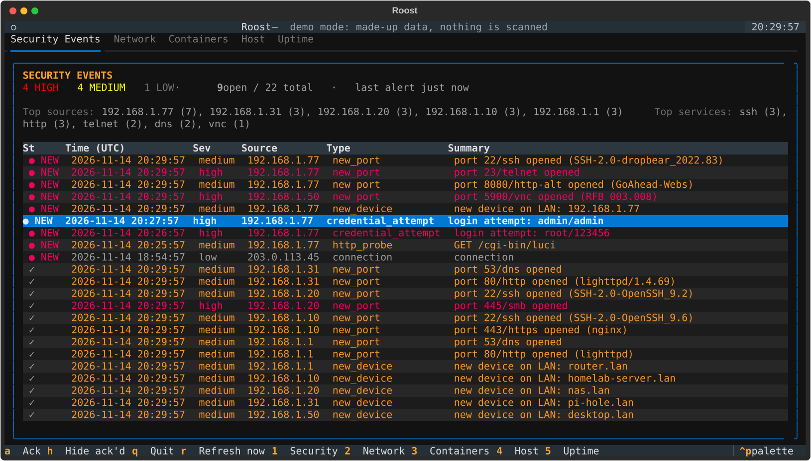
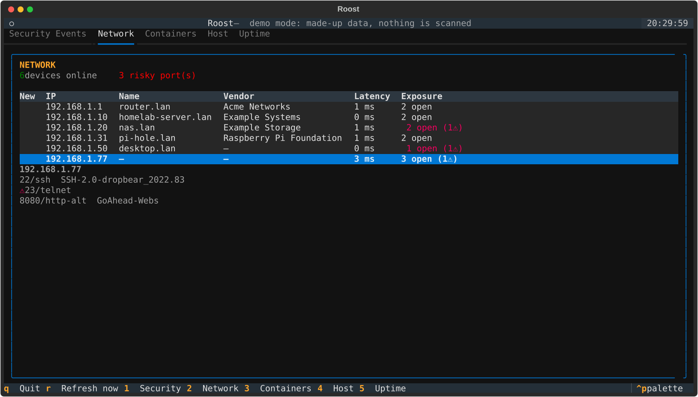
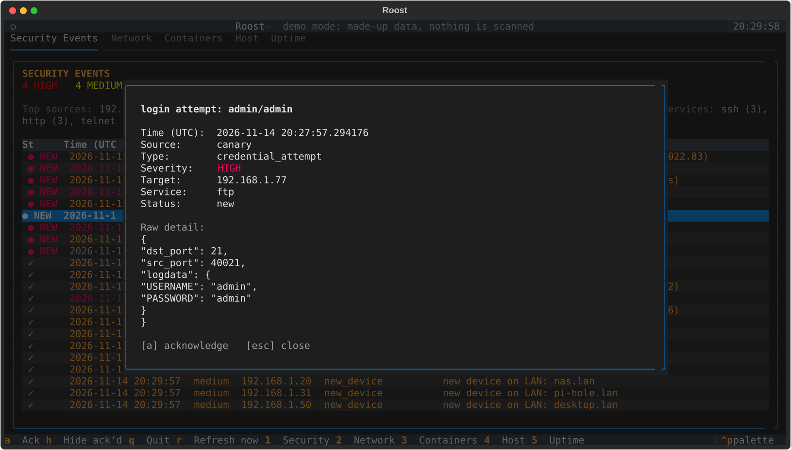
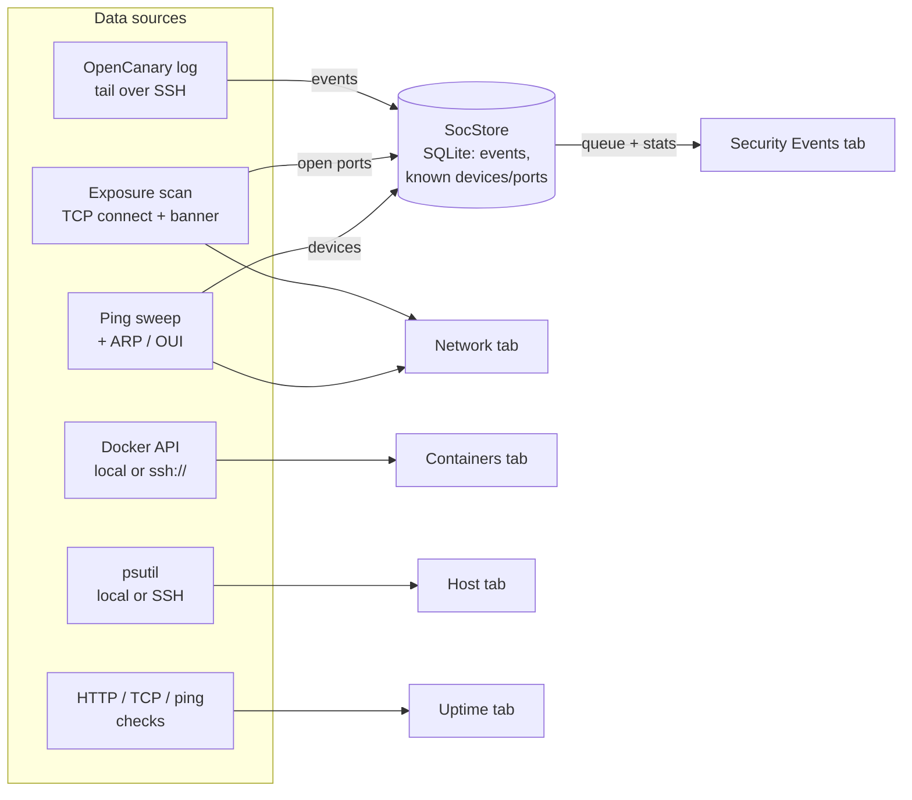

<p align="center">
  
</p>

# Roost

**A terminal SOC-lite for your homelab: one SSH session shows your containers, hosts and services, plus a triage queue of real security signals from your LAN and an OpenCanary honeypot.**

[](https://github.com/CMD126/roost/actions/workflows/tests.yml)
[](LICENSE)
[](pyproject.toml)
[](https://textual.textualize.io/)

Roost collects signals from your network and honeypot, de-duplicates and scores them, and keeps them in a persistent triage queue, scaled down from how a security operations centre (SOC) works.

**Status:** early development. Version 0.1.0 is an unreleased release candidate (see [CHANGELOG.md](CHANGELOG.md)).

- [Principles](#principles)
- [Install and run](#install-and-run)
- [Using it](#using-it)
- [Architecture](#architecture)
- [Development](#development)
- [Limits of this version](#limits-of-this-version)
- [Responsible use](#responsible-use)
- [License](#license)
- [Reference](#reference)



<sub>Screenshot generated from `roost --demo`. All hosts, addresses and events are made up.</sub>

## Principles

- Alerts are things that happened. A honeypot alert means something connected to a decoy service (for example, tried a password). A network alert means a device or open port that was not there before is there now.
- Observation only. The exposure scan is a TCP connect plus a short banner read (and a `HEAD /` on HTTP ports) against a fixed port list. It never sends credentials, payloads or exploit attempts. It is not a vulnerability scanner.
- Scope guardrails. `network.cidr` must be a private, loopback or link-local range of at most 65,536 addresses. Anything else is refused at startup; scanning a public range you own needs `network.allow_public: true`.
- Untrusted input stays inert. Honeypot fields, banners, reverse-DNS names and remote error messages are shown as plain text and control characters are stripped, so a remote service cannot push terminal escape sequences into your session.
- No passwords. Remote metrics and canary tailing call your system `ssh` with `BatchMode=yes` and a connect timeout, so they never prompt for or store a password.
- Local data stays local. `config.yaml` (internal IPs and hostnames) and the events database are gitignored.
- One failure does not take down the dashboard. Every refresh runs in its own worker; a crashing collector is logged and retried next cycle.

More on scope and how to report a problem: [SECURITY.md](SECURITY.md).

## Install and run

You need Python 3.10 or newer (CI runs 3.10 to 3.13), and `ping` on the PATH for the network sweep and ping checks. Docker is only needed for the Containers tab.

Try it with made-up data first. Demo mode scans nothing, reads no config and needs no Docker:

```bash
git clone https://github.com/CMD126/roost.git
cd roost
python -m venv .venv && source .venv/bin/activate   # Windows: .venv\Scripts\activate
pip install -e .
roost --demo
```

To point it at your own network, copy `config.example.yaml` to `config.yaml`, set `network.cidr`, and run `roost` (see [Configuration](#configuration)). Other ways to start it:

```bash
roost -c /path/to/config.yaml
python -m roost            # without the installed entry point
```

## Using it

1. Start `roost --demo` to see the layout, or `roost` with your own `config.yaml`.
2. Switch tabs with `1` to `5`. Start with Security Events: it is the triage queue.
3. Press `Enter` on an event to see its raw detail (`Esc` closes it), and `a` to acknowledge it once you have checked it. `h` hides acknowledged events.
4. In the Network tab, select a device to see its open ports and banners below the table.
5. `r` refreshes immediately, `q` quits.

| Tab | What it shows | How |
| --- | --- | --- |
| **Security Events** | Persistent triage queue of honeypot hits and network changes, with severity, open-by-severity counts, top sources/services and time since the last alert | SQLite-backed store; `a` acknowledges, `h` hides acknowledged, `Enter` shows the raw event |
| **Network** | Every live device on the LAN with hostname, MAC, vendor, latency and an exposure badge; select a row for its open ports and banners | Ping sweep, ARP table, offline OUI lookup, TCP connect + banner grab |
| **Containers** | Status, CPU % and memory per container | Docker API, local socket or a remote daemon over `ssh://` |
| **Host** | CPU, memory, disk, temperature, uptime | `psutil`, locally or on a remote machine over SSH |
| **Uptime** | Up/down and latency for a list of services | HTTP, raw TCP connect or ICMP ping |

Each panel degrades on its own: if Docker is not reachable or a section is disabled, that panel says so and the rest keep working. Security Events is a triage queue, not just a log: unacknowledged events lead, most recent first; acknowledged events sink to the bottom. Full keybindings and mouse notes are under [Running it](#running-it).

<p>
  
  
</p>

## Architecture



Each source is an `async` collector in `roost/collectors/` returning typed dataclasses (`roost/models.py`). The Textual app (`roost/app.py`) runs them on independent intervals as workers, feeds network and honeypot results through `SocStore` (`roost/soc.py`) for change detection and persistence, and hands the results to one widget per tab (`roost/widgets/`).

Modules:

```text
roost/
  collectors/
    docker_containers.py  # container list + stats, local or ssh://
    host.py               # CPU/RAM/disk/temp, local or over SSH
    uptime.py             # HTTP / TCP / ping checks
    network.py            # ping sweep + MAC/vendor enrichment
    portscan.py           # exposure scan + banner grab
    opencanary.py         # SSH-tail + parse honeypot alerts into SecurityEvents
    _arp.py, _ping.py     # small OS-shell-out helpers shared above
    _text.py              # control-character stripping for untrusted text
  widgets/       # one Textual widget per panel, plus event_detail.py (the modal)
                 # and _clickable_table.py (single-click row selection)
  soc.py         # SQLite-backed SecurityEvent store: history, triage, change detection, stats
  config.py      # YAML -> AppConfig, including scan-range validation
  app.py         # the Textual App: layout, refresh loop, keybindings
  demo.py        # --demo: the same app with canned data
  __main__.py    # CLI entry point
scripts/
  screenshots.py # renders the README screenshots headless from demo mode
```

Security-relevant design choices:

- `roost/config.py` validates the scan range at load time (`validate_scan_cidr`), so an out-of-scope `network.cidr` stops startup with an explanation.
- `roost/collectors/_text.py` strips control characters from untrusted text before it reaches a widget. Regression tests feed hostile strings through every view.
- `roost/collectors/opencanary.py` and `roost/collectors/host.py` run `ssh` with `BatchMode=yes` and `ConnectTimeout=5`. The canary log is only read with `tail`, and its path is shell-quoted.
- Docker over SSH reuses your key-based access; see [Operational notes](#operational-notes).

### How detection works

Every signal becomes a `SecurityEvent` with a source, type, severity, target and the raw detail behind it.
Events are de-duplicated by a stable key and stored in SQLite (`events_db`), together with the triage status.

| Event | Source | Fires when | Severity |
| --- | --- | --- | --- |
| `credential_attempt` | OpenCanary | A decoy service logged a username and/or password | high |
| `http_probe` | OpenCanary | A decoy logged a request path or other structured data | medium |
| `connection` | OpenCanary | Something connected to a decoy without sending anything structured | low |
| `new_device` | Network sweep | A MAC (or IP, if no MAC is known) is seen for the first time ever | medium |
| `device_returned` | Network sweep | A known device reappears after dropping off the LAN | medium |
| `new_port` | Exposure scan | A port on a known device goes from closed (or never seen) to open | high for commonly abused services (telnet, SMB, RDP, VNC, Redis, Elasticsearch, MongoDB, ...), medium otherwise |

Details that keep the queue honest:

- **Honeypot lines are classified structurally.** OpenCanary also logs its own startup and housekeeping messages. A line only counts as an interaction when it has a non-empty `src_host`, which is more reliable than hard-coding OpenCanary's internal log type numbers.
- **Change detection survives restarts.** Which devices and ports are known is persisted, not kept as an in-memory "previous scan", so restarting Roost doesn't make the whole LAN look new again. Devices are tracked by MAC so a DHCP lease change isn't a new device.
- **Only changes alert.** A port closing or a device leaving updates state silently, so a later reopening or return can be detected.
- **The queue is ordered for triage:** unacknowledged first, newest first within that.

## Development

```bash
pip install -e ".[dev]"
ruff check .
python -m pytest -q
python scripts/screenshots.py   # regenerate docs/*.svg from demo mode
```

Tests cover the config loader (including the scan-range guardrails), each collector (mostly against real loopback
targets (a throwaway TCP server for the port scanner, including a silent one and one that sends escape sequences)),
the SQLite event store and change detection, demo mode, and headless runs of the full Textual app via
`App.run_test()`, including hostile honeypot and banner strings. CI runs lint and tests on Python 3.10 to 3.13.

CI (`.github/workflows/tests.yml`) also builds the package; see [Build a release candidate](#build-a-release-candidate).

## Limits of this version

- Early development: 0.1.0 is unreleased and nothing in the repository publishes it to PyPI.
- The exposure scan is noisy by nature and the "risky ports" flag is a heuristic ("commonly abused when exposed"), not a verdict that a device is vulnerable. CVE correlation is not implemented.
- OpenCanary and remote host monitoring need separately configured, key-based SSH access. Roost does not deploy a honeypot.
- Automated platform coverage is Ubuntu with Python 3.10 to 3.13. Other operating systems are not covered by CI.
- Builds are checked as source and wheel distributions with a CLI and version smoke check. That does not establish production readiness or replace testing against your own lab.

## Responsible use

Roost actively probes the network it is pointed at. The exposure scan opens a TCP connection to every configured port on every live host (every `network.portscan.interval`, default 5 minutes), which on someone else's network looks like reconnaissance. Only point `network.cidr` at ranges you are authorized to scan. See [SECURITY.md](SECURITY.md) for scope and how to report a problem.

## License

MIT. See [LICENSE](LICENSE).

## Reference

Longer material, in the order you are likely to need it.

### Configuration

Copy the example config and point it at your own homelab:

```bash
cp config.example.yaml config.yaml
```

`config.yaml` is gitignored, so it's the right place for internal IPs and
hostnames. They never get committed. See the comments in
[`config.example.yaml`](config.example.yaml) for every option:

- `docker.host`: leave `null` for the local daemon, or `ssh://user@host` for a remote one (see [Operational notes](#operational-notes)).
- `host.remote`: optional `{ssh_target, python}` to collect Host panel metrics from a remote machine over SSH instead of the local one.
- `uptime.targets`: a list of `{name, type: http|tcp|ping, url|address, port}` entries.
- `network.cidr`: the LAN range to sweep, e.g. `192.168.1.0/24`. Must be private/loopback/link-local and at most a /16, unless `network.allow_public: true` (see [Safety and threat model](#principles)).
- `network.portscan`: exposure scan settings: `enabled`, `interval`, `timeout`, `concurrency`, and an optional custom `ports` list.
- `canary`: `{enabled, ssh_target, log_path, tail_lines, interval}` for OpenCanary tailing. A log line counts as a real alert (not internal housekeeping) when it has a non-empty `src_host`. Feeds into the Security Events panel.
- `events_db`: SQLite file backing the Security Events panel's history and triage state, resolved relative to `config.yaml`'s directory. Defaults to `roost_events.db`, gitignored like `config.yaml`.

If `config.yaml` doesn't exist, the app still runs with built-in defaults
(host metrics only), which is handy for a first `git clone && run` sanity check.

### Connecting to a remote host

Three of the five panels, Docker (`docker.host: ssh://...`), Host
(`host.remote`) and Security Events (`canary`), reach a machine over SSH rather than
inspecting the one Roost runs on. All three need **key-based, passwordless
SSH**. Roost never prompts for a password, so a login that requires one will
just silently fail or time out. If you don't have that set up yet for your
target machine:

```bash
# 1. Generate a key dedicated to this (keeps it separate from any other key
#    you already use, and means it's safe to leave passwordless):
ssh-keygen -t ed25519 -f ~/.ssh/id_ed25519_roost -N "" -C "roost"

# 2. Copy the public key to the target (asks for that machine's password once,
#    the last time you'll need it):
cat ~/.ssh/id_ed25519_roost.pub | ssh youruser@yourhost \
  "mkdir -p ~/.ssh && chmod 700 ~/.ssh && cat >> ~/.ssh/authorized_keys && chmod 600 ~/.ssh/authorized_keys"

# 3. Register it so any tool (ssh, and Roost's docker-py/paramiko underneath
#    it) picks the right key automatically for this host, no -i flag needed:
cat >> ~/.ssh/config <<'EOF'

Host yourhost
    HostName <ip-or-hostname>
    User youruser
    IdentityFile ~/.ssh/id_ed25519_roost
    IdentitiesOnly yes
EOF

# 4. Confirm it works without a password prompt:
ssh -o BatchMode=yes yourhost "echo connected"
```

Once that last command prints `connected` without asking for anything, every
`ssh_target`/`docker.host: ssh://...` in the config below pointed at that
host will work the same way.

### Setting up OpenCanary

Roost doesn't run a honeypot itself. It just tails one over SSH. Check
whether you already have it somewhere:

```bash
ssh youruser@yourhost "pip show opencanary 2>/dev/null || echo 'not installed'"
```

If it's not installed, set it up in its own venv:

```bash
python3 -m venv ~/opencanary-env
~/opencanary-env/bin/pip install opencanary
~/opencanary-env/bin/opencanaryd --copyconfig   # writes ~/.opencanary.conf
```

Edit the generated config to enable the services you want (`ftp.enabled`,
`ssh.enabled`, `http.enabled`, ...), and pick ports that don't collide with
anything real already running there (check with `sudo ss -tlnp` first).

Run it as a systemd service so it survives reboots:

```ini
# /etc/systemd/system/opencanary.service
[Unit]
Description=OpenCanary Honeypot
After=network.target

[Service]
Type=forking
PIDFile=/var/run/opencanaryd.pid
User=youruser
WorkingDirectory=/home/youruser
ExecStart=/home/youruser/opencanary-env/bin/opencanaryd --start
Restart=on-failure

[Install]
WantedBy=multi-user.target
```

**`Type=forking` is not optional.** `opencanaryd --start` launches the real
daemon via an internal `sudo twistd ...` and then exits itself. Without
`Type=forking` + `PIDFile`, systemd tracks the wrong process, sees it exit,
and kills the whole cgroup a few seconds later. It'll show `active` for an
instant and then crash-loop forever. Ask us how we know.

Then:

```bash
sudo systemctl daemon-reload
sudo systemctl enable --now opencanary
sudo ufw allow from <your-lan-cidr> to any port <each-decoy-port> proto tcp
```

**Known gotcha:** some OpenCanary 0.9.x installs ship the `basicLogin` HTTP
skin without its `redirect.html`, so every request 500s instead of getting
logged. If that happens, switch to a complete skin: add
`"http.skin": "nasLogin"` to the config and restart the service.

Once it's up, point Roost's `canary` config (see above) at its `ssh_target`
and `log_path`.

### Running it

```bash
roost                      # uses ./config.yaml
roost -c /path/to/config.yaml
roost --demo               # made-up data, scans nothing
# or, without installing the entry point:
python -m roost
```

Each panel (Security Events, Network, Containers, Host, Uptime) is its own
full-height tab rather than sharing a cramped grid, so a table actually has
room to show more than a handful of rows at once. Security Events is a
triage queue, not just a log: unacknowledged events lead, most recent first
within that (chronological, not weighted by severity); acknowledged events
sink to the bottom.

Keybindings: `1` to `5` jump straight to a tab (Security/Network/Containers/
Host/Uptime) regardless of mouse or focus state; `r` refreshes immediately;
`q` quits. `↑`/`↓` move through a table. On the Network panel, this also
updates the port/banner detail shown below it for whichever device is
selected. On the Security Events panel: `Enter` (or a mouse click) opens the
full detail for the selected event in a popup (`Esc` to close), `a`
acknowledges/triages the selected event (from the table or from inside the
popup), and `h` toggles hiding already-acknowledged events from the queue.
Switching tabs (by number key, clicking a tab header, or the mouse) always
moves keyboard focus into that tab's table, so `↑`/`↓` work immediately
without an extra click first.

Mouse support is on by default (click a row instead of navigating with the
keyboard). Set `mouse: false` in `config.yaml` if you're stuck on a legacy
Windows console (`conhost.exe`, not Windows Terminal) that leaks raw mouse
escape sequences as visible text instead of consuming them. The same
console can also leak a stray `^[[I`/`^[[O` when the window gains or loses
focus; switching to Windows Terminal resolves both.

### Operational notes

A few points worth knowing before you point it at a real network:

- **Docker over SSH, not `tcp://`.** A plain `tcp://host:2375` exposes the
  Docker API with no authentication to anyone on that network segment,
  which is root-equivalent access to the host. Prefer `docker.host: "ssh://user@host"`,
  which reuses your existing key-based SSH access and exposes nothing new.
- **The exposure scan is noisy by nature.** It opens a TCP connection to every
  configured port on every live host, on an interval (`network.portscan.interval`,
  default 5 minutes). On someone else's network this would look like exactly
  what it is: reconnaissance. Only point `network.cidr` at ranges you're
  authorized to scan.
- **The "risky ports" list is a heuristic, not a verdict.** It flags ports
  that are *commonly* problematic when exposed (unauthenticated by default,
  legacy cleartext protocols, common ransomware/worm entry points). It does not mean
  "this specific device is vulnerable." A flagged VNC port with a strong
  password is fine; an unflagged custom port could still be misconfigured.

### Build a release candidate

```bash
python -m pip install build twine
python -m build
python -m twine check --strict dist/*
```

This produces a source archive and a wheel in `dist/`. The source archive
includes `config.example.yaml`, the security policy and the
[release notes](CHANGELOG.md). CI also installs the wheel into a clean
environment, checks the CLI and version, and attaches the distributions to
the workflow run. It does not publish a GitHub release or upload to PyPI.

### Roadmap

Built so far: asset inventory (MAC/vendor), exposure scanning, real honeypot
alerts (OpenCanary), and a SOC-lite Security Events log with persistent history,
severity + triage, network change detection and attacker/source rollup stats.
Not yet built, in rough order of value:

- **CVE correlation:** cross-reference banner-detected service versions against a vulnerability database, instead of just flagging ports by category.

### Acknowledgments

The OpenCanary alerts panel was inspired by [Kat](https://github.com/rnbwkat)'s
honeypot workshop at BSides Porto. That's what got me thinking about pairing
a homelab dashboard with real intrusion signals instead of just uptime checks.
