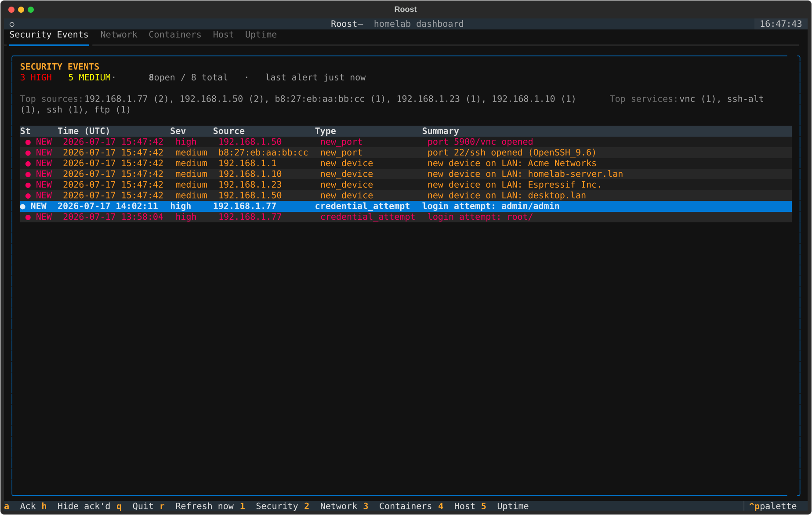

# Roost

A terminal dashboard for keeping an eye on a homelab: Docker containers, host
resources, service uptime, and what's alive and exposed on the LAN. No
browser, no agent to install on every box — just SSH in and run it.



<sub>Demo data — device names, IPs and container list above are fictional, not a real deployment.</sub>

## Features

- **Containers** — status, CPU % and memory per container, via the Docker API. Local socket, or a remote daemon reached over SSH (`ssh://user@host`) or `tcp://` (see [Security notes](#security-notes)).
- **Host** — CPU, memory, disk and temperature. Of the machine running the dashboard by default, or of a remote machine reached over SSH — see `host.remote` in the config.
- **Uptime** — a configurable list of services checked over HTTP, raw TCP connect, or ICMP ping.
- **Network** — a ping sweep of a configured CIDR range, enriched with:
  - **MAC address + vendor** (offline OUI lookup) — identifies a device even when it has no reverse DNS entry, which is most consumer/IoT gear.
  - **Exposure scan** — TCP connect + banner grab against a curated list of commonly-exposed ports (SSH, HTTP(S), SMB, RDP, VNC, Redis, databases, ...). Ports that are historically common unauthenticated/legacy attack surface (telnet, SMB, RDP, VNC, rpcbind, Redis, Elasticsearch, MongoDB...) are flagged in red. **This is a connect + banner check, not a CVE scanner** — it tells you a door is open and roughly what's behind it, not whether it's currently vulnerable. The table stays compact (one badge per device); select a row to see the full port/banner breakdown below it.
- **Security Events** — a unified, persistent triage queue combining two kinds of real signal (not heuristics): interactions with an [OpenCanary](https://github.com/thinkst/opencanary) honeypot tailed over SSH (a row means something actually connected to a decoy service and, say, tried a username/password), and network changes detected against the Network panel's history (a new device joins the LAN, or a previously-closed port opens on a known device). Each event is scored `high`/`medium`/`low` severity, survives restarts (SQLite, `events_db` in config), and shows a rollup of top source IPs/services, open-by-severity counts, and time since the last alert. Unacknowledged events lead the queue, most recent first within that — chronological, not weighted by severity. Click (or select + `Enter`) a row for the full raw detail in a popup; `a` acknowledges/triages, `h` hides acknowledged events. Canary tailing is off by default (`canary.enabled: false`) — there's nothing to show until you've deployed a canary somewhere; network change detection runs automatically whenever the Network panel is enabled.

Each panel degrades gracefully: if Docker isn't reachable, or a config
section is disabled, that panel says so instead of crashing the app.

## Security notes

This project actively probes hosts on your network (ping sweep, port
connects, banner grabs). That's fine on infrastructure you own or are
authorized to test — which is the only intended use. A few things worth
knowing:

- **Docker over SSH, not `tcp://`.** A plain `tcp://host:2375` exposes the
  Docker API with no authentication to anyone on that network segment —
  root-equivalent access to the host. Prefer `docker.host: "ssh://user@host"`,
  which reuses your existing key-based SSH access and exposes nothing new.
- **The exposure scan is noisy by nature.** It opens a TCP connection to every
  configured port on every live host, on an interval (`network.portscan.interval`,
  default 5 minutes). On someone else's network this would look like exactly
  what it is — reconnaissance. Only point `network.cidr` at ranges you're
  authorized to scan.
- **The "risky ports" list is a heuristic, not a verdict.** It flags ports
  that are *commonly* problematic when exposed (unauthenticated by default,
  legacy cleartext protocols, common ransomware/worm entry points) — not
  "this specific device is vulnerable." A flagged VNC port with a strong
  password is fine; an unflagged custom port could still be misconfigured.

## Requirements

- Python 3.10+
- Docker Engine reachable from wherever you run this (only needed for the Containers panel)

## Installation

```bash
git clone <repo-url>
cd roost
python -m venv .venv
source .venv/bin/activate        # Windows: .venv\Scripts\activate
pip install -e .
```

## Connecting to a remote host

Three of the five panels — Docker (`docker.host: ssh://...`), Host
(`host.remote`), and Alerts (`canary`) — reach a machine over SSH rather than
inspecting the one Roost runs on. All three need **key-based, passwordless
SSH** — Roost never prompts for a password, so a login that requires one will
just silently fail/timeout. If you don't have that set up yet for your
target machine:

```bash
# 1. Generate a key dedicated to this (keeps it separate from any other key
#    you already use, and means it's safe to leave passwordless):
ssh-keygen -t ed25519 -f ~/.ssh/id_ed25519_roost -N "" -C "roost"

# 2. Copy the public key to the target (asks for that machine's password once,
#    the last time you'll need it):
cat ~/.ssh/id_ed25519_roost.pub | ssh youruser@yourhost \
  "mkdir -p ~/.ssh && chmod 700 ~/.ssh && cat >> ~/.ssh/authorized_keys && chmod 600 ~/.ssh/authorized_keys"

# 3. Register it so any tool (ssh, and Roost's docker-py/paramiko underneath
#    it) picks the right key automatically for this host, no -i flag needed:
cat >> ~/.ssh/config <<'EOF'

Host yourhost
    HostName <ip-or-hostname>
    User youruser
    IdentityFile ~/.ssh/id_ed25519_roost
    IdentitiesOnly yes
EOF

# 4. Confirm it works without a password prompt:
ssh -o BatchMode=yes yourhost "echo connected"
```

Once that last command prints `connected` without asking for anything, every
`ssh_target`/`docker.host: ssh://...` in the config below pointed at that
host will work the same way.

## Configuration

Copy the example config and point it at your own homelab:

```bash
cp config.example.yaml config.yaml
```

`config.yaml` is gitignored — it's the right place for internal IPs and
hostnames, they never get committed. See the comments in
[`config.example.yaml`](config.example.yaml) for every option:

- `docker.host` — leave `null` for the local daemon, or `ssh://user@host` for a remote one (see [Security notes](#security-notes)).
- `host.remote` — optional `{ssh_target, python}` to collect Host panel metrics from a remote machine over SSH instead of the local one.
- `uptime.targets` — a list of `{name, type: http|tcp|ping, url|address, port}` entries.
- `network.cidr` — the LAN range to sweep, e.g. `192.168.1.0/24`.
- `network.portscan` — exposure scan settings: `enabled`, `interval`, `timeout`, `concurrency`, and an optional custom `ports` list.
- `canary` — `{enabled, ssh_target, log_path, tail_lines, interval}` for OpenCanary tailing. A log line counts as a real alert (not internal housekeeping) when it has a non-empty `src_host`. Feeds into the Security Events panel.
- `events_db` — SQLite file backing the Security Events panel's history and triage state, resolved relative to `config.yaml`'s directory. Defaults to `roost_events.db`, gitignored like `config.yaml`.

If `config.yaml` doesn't exist, the app still runs with built-in defaults
(host metrics only) — useful for a first `git clone && run` sanity check.

### Setting up OpenCanary (if you don't have one yet)

Roost doesn't run a honeypot itself — it just tails one over SSH. Check
whether you already have it somewhere:

```bash
ssh youruser@yourhost "pip show opencanary 2>/dev/null || echo 'not installed'"
```

If it's not installed, set it up in its own venv:

```bash
python3 -m venv ~/opencanary-env
~/opencanary-env/bin/pip install opencanary
~/opencanary-env/bin/opencanaryd --copyconfig   # writes ~/.opencanary.conf
```

Edit the generated config to enable the services you want (`ftp.enabled`,
`ssh.enabled`, `http.enabled`, ...), and pick ports that don't collide with
anything real already running there — check with `sudo ss -tlnp` first.

Run it as a systemd service so it survives reboots:

```ini
# /etc/systemd/system/opencanary.service
[Unit]
Description=OpenCanary Honeypot
After=network.target

[Service]
Type=forking
PIDFile=/var/run/opencanaryd.pid
User=youruser
WorkingDirectory=/home/youruser
ExecStart=/home/youruser/opencanary-env/bin/opencanaryd --start
Restart=on-failure

[Install]
WantedBy=multi-user.target
```

**`Type=forking` is not optional.** `opencanaryd --start` launches the real
daemon via an internal `sudo twistd ...` and then exits itself. Without
`Type=forking` + `PIDFile`, systemd tracks the wrong process, sees it exit,
and kills the whole cgroup a few seconds later — it'll show `active` for an
instant and then crash-loop forever. Ask us how we know.

Then:

```bash
sudo systemctl daemon-reload
sudo systemctl enable --now opencanary
sudo ufw allow from <your-lan-cidr> to any port <each-decoy-port> proto tcp
```

**Known gotcha:** some OpenCanary 0.9.x installs ship the `basicLogin` HTTP
skin without its `redirect.html`, so every request 500s instead of getting
logged. If that happens, switch to a complete skin: add
`"http.skin": "nasLogin"` to the config and restart the service.

Once it's up, point Roost's `canary` config (see above) at its `ssh_target`
and `log_path`.

## Running it

```bash
roost                      # uses ./config.yaml
roost -c /path/to/config.yaml
# or, without installing the entry point:
python -m roost
```

Each panel is its own full-height tab — Security Events, Network, Containers,
Host, Uptime — rather than sharing a cramped grid, so a table actually has
room to show more than a handful of rows at once. Security Events is a
triage queue, not just a log: unacknowledged events lead, most recent first
within that (chronological, not weighted by severity); acknowledged events
sink to the bottom.

Keybindings: `1`–`5` jump straight to a tab (Security/Network/Containers/
Host/Uptime) regardless of mouse or focus state; `r` refreshes immediately;
`q` quits. `↑`/`↓` move through a table — on the Network panel, this also
updates the port/banner detail shown below it for whichever device is
selected. On the Security Events panel: `Enter` (or a mouse click) opens the
full detail for the selected event in a popup (`Esc` to close), `a`
acknowledges/triages the selected event (from the table or from inside the
popup), and `h` toggles hiding already-acknowledged events from the queue.
Switching tabs — by number key, clicking a tab header, or the mouse — always
moves keyboard focus into that tab's table, so `↑`/`↓` work immediately
without an extra click first.

Mouse support is on by default (click a row instead of navigating with the
keyboard). Set `mouse: false` in `config.yaml` if you're stuck on a legacy
Windows console (`conhost.exe`, not Windows Terminal) that leaks raw mouse
escape sequences as visible text instead of consuming them — the same
console can also leak a stray `^[[I`/`^[[O` when the window gains or loses
focus; switching to Windows Terminal resolves both.

## Development

```bash
pip install -e ".[dev]"
pytest
```

Tests cover the config loader, each collector (against real loopback/public
targets and a real throwaway TCP server for the port scanner — no mocks),
and a headless run of the full Textual app via `App.run_test()`.

## Project structure

```text
roost/
  collectors/
    docker_containers.py  # container list + stats, local or ssh://
    host.py                # CPU/RAM/disk/temp, local or over SSH
    uptime.py               # HTTP / TCP / ping checks
    network.py               # ping sweep + MAC/vendor enrichment
    portscan.py               # exposure scan + banner grab
    opencanary.py               # SSH-tail + parse honeypot alerts into SecurityEvents
    _arp.py, _ping.py          # small OS-shell-out helpers shared above
  widgets/       # one Textual widget per panel, plus event_detail.py (the modal)
                 # and _clickable_table.py (single-click row selection)
  soc.py         # SQLite-backed SecurityEvent store: history, triage, change detection, stats
  config.py      # YAML -> AppConfig
  app.py         # the Textual App: layout, refresh loop, keybindings
  __main__.py    # CLI entry point
```

## Roadmap

Built so far: asset inventory (MAC/vendor), exposure scanning, real honeypot
alerts (OpenCanary), and a SOC-lite Security Events log — persistent history,
severity + triage, network change detection, attacker/source rollup stats.
Not yet built, in rough order of value:

- **CVE correlation** — cross-reference banner-detected service versions against a vulnerability database, instead of just flagging ports by category.

## Acknowledgments

The OpenCanary alerts panel was inspired by [Kat](https://github.com/rnbwkat)'s
honeypot workshop at BSides Porto — that's what got me thinking about pairing
a homelab dashboard with real intrusion signals instead of just uptime checks.

## License

MIT.
